# Batalha de Cartas — Goblins

Trabalho 2 — **Batalha de Cartas**. Jogo de cartas por turnos para **dois jogadores no mesmo aparelho**, feito em Unity com uGUI (Canvas). Não há multiplayer em rede nem inteligência artificial.

- **Autor:** Gabriel Jaycon
- **Engine:** Unity 6.3 LTS (6000.3.x), Universal 2D
- **Animações:** DOTween (versão gratuita, Demigiant)
- **Orientação:** retrato (Portrait) fixo
- **Cena principal:** uma única cena; todas as telas são Canvas dentro dela

## Como rodar

1. Abra o projeto no Unity Hub com a versão 6.3 LTS.
2. Importe o **DOTween** pelo Package Manager (My Assets) e rode **Tools > Demigiant > DOTween Utility Panel > Setup DOTween**, com o módulo **UI** marcado. (Se o projeto já veio com o DOTween em `Assets/Plugins/Demigiant`, não é necessário.)
3. Abra a cena principal e aperte **Play**.
4. Para testar em vários aparelhos, use a aba **Simulator** (ao lado da aba Game) e escolha o aparelho antes de dar Play.
5. Aparelhos usados nos testes: iPhone SE (16:9), **Celular 20:9 com notch (custom)** (arquivo `.device` em `Assets/_Project/Devices`), Apple iPhone X, Huawei P40 Pro e iPad (4:3).

## Como jogar

1. **Menu:** título **GobCard** (imagem), com os botões Iniciar, Créditos e Sair.
2. **Seleção de cartas:** cada jogador escolhe 2 das 10 cartas. As cartas escolhidas pelo Jogador 1 ficam bloqueadas para o Jogador 2. O botão "Ver descrição" abre a tela de descrição, com arte, atributos base, habilidade e a história completa (com rolagem).
3. **Distribuição de pontos:** para cada um dos 4 personagens, o jogador distribui **20 pontos** entre Força, Velocidade, Intelecto, Destreza e Raiva (máximo **10 por atributo**). A prévia do efeito de cada atributo atualiza a cada ponto, e segurar o botão `+` ou `-` repete e acelera. Só é possível confirmar com 0 pontos restantes.
4. **Batalha:** o celular fica deitado entre os dois jogadores. As cartas do Jogador 2 ficam viradas 180° para ele. O jogador da vez escolhe o alvo e toca no botão de ataque (a espada), no centro da tela.
5. **Resultado:** vencedor, turnos jogados e dano total de cada jogador, com opção de jogar novamente ou voltar ao menu.

## Os personagens

Todos os personagens são originais. Vida e dano base são os valores de partida de cada carta; os pontos distribuídos pelos jogadores se somam a eles. Os percentuais das habilidades ficam no Inspector de cada carta (ScriptableObject) e podem ser ajustados sem mexer no código.

| | Personagem | Vida | Dano base | Habilidade |
|---|---|---|---|---|
| 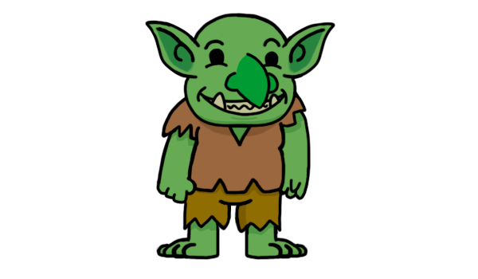 | **Goblin Feliz** | 100 | 10 a 25 | **Inspirar** (ativa): aumenta em 50% o dano da carta aliada na próxima ação dela, sem gastar o próprio ataque. Recarga de 3 turnos |
| 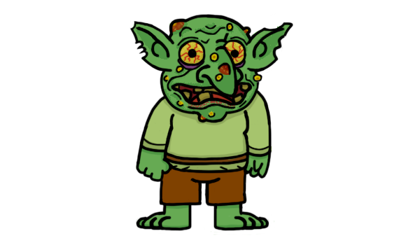 | **Goblin Feio** | 50 | 10 a 30 | **Medo** (passiva): enquanto estiver em campo, os inimigos têm 10% de chance de errar o ataque (sorteio separado, não soma com o Intelecto) |
| 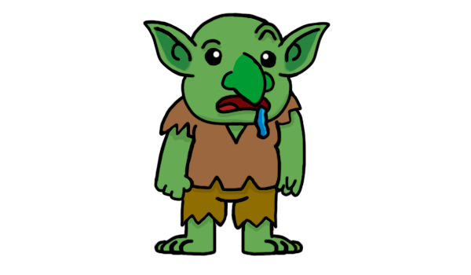 | **Goblin Burro** | 150 | 15 a 35 | **Atrapalhado** (passiva): 20% de chance de errar o próprio ataque |
| 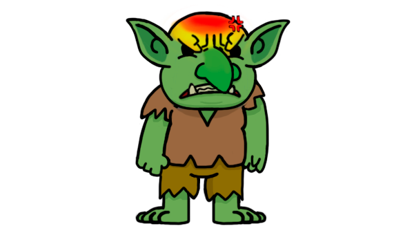 | **Goblin Irritado** | 80 | 15 a 40 | **Fúria explosiva** (passiva): com a vida abaixo de 30%, 15% de chance de causar o dobro de dano |
| 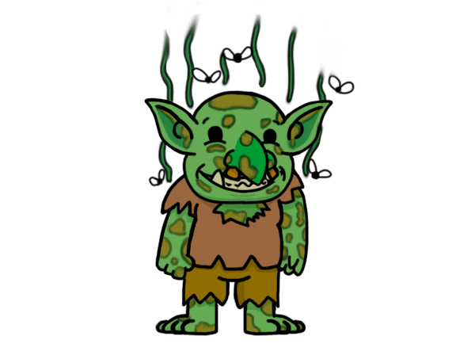 | **Goblin Fedido** | 150 | 10 a 25 | **Escudo** (passiva): reduz em 50% todo o dano recebido |
| 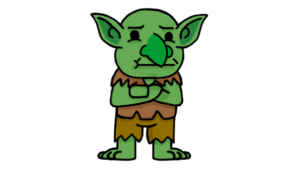 | **Goblin Chato** | 200 | 10 a 20 | **Acumular** (ativa): em vez de atacar, guarda o dano do turno (até 3 vezes) e solta tudo de uma vez no próximo ataque |
| 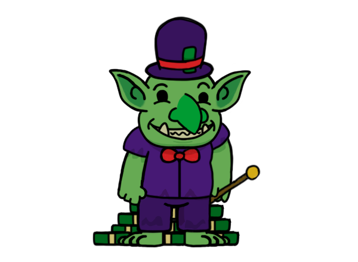 | **Goblin Rico** | 80 | 10 a 30 | **Comprar** (ativa): em vez de atacar, compra uma carta inimiga, que ataca uma carta do próprio time e perde a próxima ação. Recarga de 2 turnos |
| 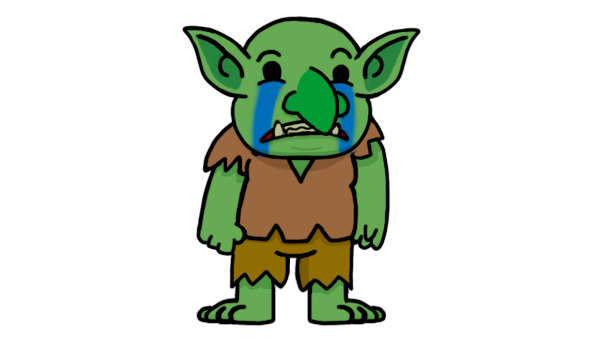 | **Goblin Chorão** | 50 | 10 a 25 | **Tristeza** (passiva): as cartas inimigas ficam tristes durante toda a batalha, com 25% de chance de não atacar em cada tentativa |
| 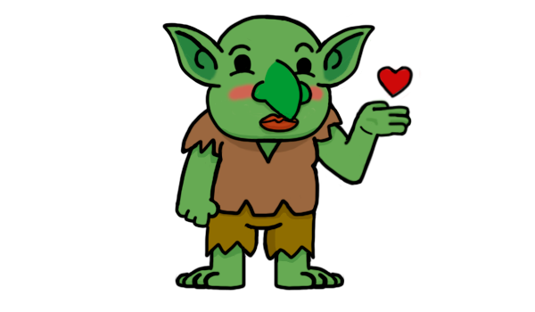 | **Goblin Lindo** | 100 | 10 a 25 | **Beleza curativa** (passiva): no começo da vez, se cura entre 5% (vida cheia) e 30% (vida quase zerada) da vida máxima |
| 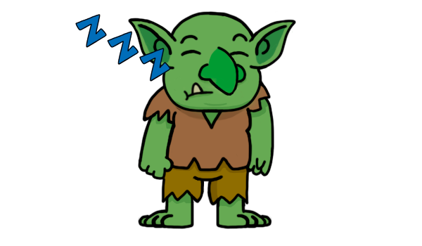 | **Goblin Dorminhoco** | 100 | 10 a 25 | **Soneca** (ativa): dorme e fica inativo por 2 rodadas; ao acordar, recupera toda a vida |

As habilidades ativas aparecem como um botão na própria carta, só na carta que está agindo. O estado de cada carta (ZZZ, ESCUDO, TRISTE, MEDO, CARGA, COMPRADO, +50% DANO) aparece escrito sobre ela.

## Regras de combate

Os cinco atributos e a ordem de resolução do ataque seguem o PDF. Os valores numéricos são constantes em `CombatRules`.

| Atributo | Efeito | Por ponto | Teto |
|---|---|---|---|
| Força | Desloca o intervalo de dano (mínimo e máximo) | +2 | — |
| Velocidade | Chance de a carta atacar de novo | +5% (base 5%) | até 3 ataques seguidos |
| Intelecto | Chance de esquiva (dano zero) | +3% | 30% |
| Destreza | Chance de crítico (dano x1,8, arredondado) | +7% | 70% |
| Raiva | Bônus de dano com a vida abaixo de 30% | +6% | — |

**Ordem de resolução de um ataque:** dano acumulado (Chato), erro do Burro, medo do Feio, esquiva do defensor (Intelecto), sorteio do dano (Força), crítico (Destreza), fúria (Raiva), dano dobrado (Irritado), bônus de inspiração (Feliz), penalidade do primeiro turno e escudo do alvo (Fedido).

### Fluxo de turnos (adaptação do PDF)

- Uma **rodada** é o turno de um jogador seguido do turno do outro. A ordem é sempre: jogador A carta 1, jogador A carta 2, jogador B carta 1, jogador B carta 2, e então volta ao jogador A.
- Quem abre a batalha é sorteado **uma vez**, no início, com o peso do PDF: a soma de `(velocidade + 1)` dos personagens vivos de cada jogador. (Há uma opção no Inspector do `BattleController` para sortear de novo a cada rodada.)
- O atacante é automático (1ª carta viva, depois a 2ª). O jogador só escolhe o **alvo**, qualquer carta viva do adversário.
- **Ataque extra:** depois de cada ataque, a carta sorteia um número de 0 a 19. Se ele for menor que `velocidade + 1`, ataca de novo, até 3 vezes no total. Isso dá `(velocidade + 1) / 20` de chance (5% com velocidade 0, 55% com velocidade 10). O sorteio é igual para os dois jogadores e não depende do adversário.
- **Equilíbrio:** o jogador que abre a batalha causa **25% menos dano no primeiro turno dele** (constante `FirstTurnDamageMultiplier`; `1` desativa). A tela mostra um aviso durante esse turno.
- Quando um personagem chega a 0 de vida, ele sai de campo. Perde quem ficar sem personagens.
- "Turnos jogados" no resultado é o **total de ataques** (um ataque por turno, como no PDF).

## Animações (DOTween)

| Momento | Animação |
|---|---|
| Início da batalha | As cartas saem do botão central e chegam à mão de cada jogador, girando e crescendo, com um pouco de poeira ao pousar |
| Ataque | Uma cópia da carta atacante voa por cima de tudo até a carta alvo, deixando um rastro de faíscas. O dano só é calculado no impacto. Depois ela volta ao lugar |
| Impacto | Acerto: o alvo pisca e treme, com faíscas. Crítico e dano dobrado: mais faíscas e a tela treme. Esquiva: o alvo desvia de lado. Erro: a atacante tropeça |
| Morte | A carta treme e se esfarela em pedaços que caem de cima para baixo, na direção do dono da carta |

## Feedback visual

| Evento | Feedback |
|---|---|
| Dano causado | Número flutuante sobre o alvo |
| Esquiva | "Esquivou!" sobre o defensor |
| Crítico | Número maior e amarelo |
| Fúria ativa | Retrato avermelhado, barra de vida laranja, selo "FÚRIA" e texto "Fúria!" no ataque |
| Turno atual | Painel do jogador da vez aceso, moldura verde no atacante e laranja no alvo, e um status por jogador |
| Personagem derrotado | A carta se esfarela e sai de campo |
| Ataque extra | "Ataca de novo!" e contador de ataques (1/3, 2/3, 3/3) |

Cada jogador tem um **log próprio** com as últimas jogadas das suas cartas (opção no Inspector para mostrar também os ataques recebidos). O botão **(i)** de cada carta abre os atributos de qualquer personagem, e o painel pode ser virado 180°.

## Estrutura do projeto

```
Assets/_Project/
  Atlases/        Sprite Atlas (arte das cartas, ícones e UI)
  Cards/          ScriptableObjects das 10 cartas
  Devices/        Dispositivo customizado do Device Simulator (.device)
  Prefabs/        CardButton, AttributeRow, CharacterSlot
  ScriptData/     Dados: CardData, AttributePoints, CharacterRuntime, GameSession
  ScriptsCombat/  Regras de combate (CombatRules)
  ScriptsUI/      Telas, controladores e animações
  UI/             Arte de interface
docs/personagens/ Imagens dos personagens usadas neste README
docs/interface/   Imagens de interface (título, botões e botão de ataque)
docs/licencas/    Licença da fonte (SIL Open Font License)
```

### Scripts principais

| Script | Função |
|---|---|
| `CardData` | ScriptableObject com nome, arte, história, vida, dano e habilidade. Nunca é alterado durante a partida |
| `AttributePoints` | Pontos distribuídos (20 no total, máximo 10 por atributo) |
| `CharacterRuntime` | Estado de um personagem em partida: vida atual, pontos e estado das habilidades. Tem os eventos `HealthChanged`, `StatusChanged` e `Defeated` |
| `GameSession` | Dados da partida: cartas, times, vencedor, turnos e dano total |
| `CombatRules` | Todas as regras e constantes de combate |
| `ScreenManager` | Troca de telas ligando e desligando `Canvas.enabled` e `GraphicRaycaster`, sem `SetActive` na raiz |
| `SafeAreaFitter` | Aplica `Screen.safeArea` ao painel de conteúdo de cada tela |
| `CardSelectionController`, `PointDistributionController`, `BattleController`, `ResultScreenController`, `DescriptionScreenController` | Lógica de cada tela |
| `CharacterSlotView`, `CardView`, `AttributeRowView`, `CardInfoPopup`, `FloatingTextPool`, `FlexibleGrid`, `HoldRepeatButton` | Componentes de UI reutilizáveis |
| `CardFx` | Animações de chegada, ataque e morte (DOTween) |

## Fonte e arte de interface

### Fonte

Os textos da interface usam a fonte **MedievalSharp**, importada no Unity como fonte do TextMeshPro.

- **Autor:** wmk69 (wmk69@o2.pl), Copyright (c) 2011
- **Licença:** SIL Open Font License, Versão 1.1 (https://openfontlicense.org)
- **Texto completo da licença:** [`docs/licencas/OFL-MedievalSharp.txt`](docs/licencas/OFL-MedievalSharp.txt)

A licença permite usar e distribuir a fonte junto com o jogo, desde que o aviso de copyright e o texto da licença acompanhem as cópias e que a fonte não seja vendida isoladamente. Por isso o arquivo `OFL.txt` fica guardado junto da fonte no projeto e também em `docs/licencas`.

### Imagens de interface

| Imagem | Arquivo | Onde é usada |
|---|---|---|
| 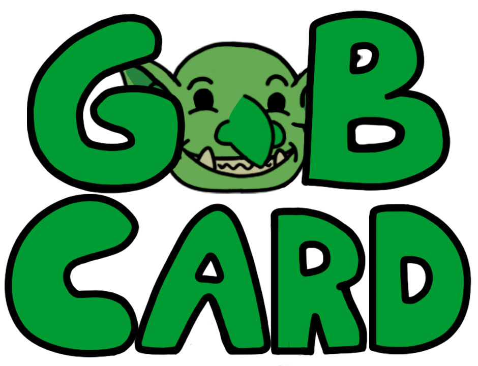 | `GobCard.png` | Título do jogo, no lugar do texto do título no menu |
| 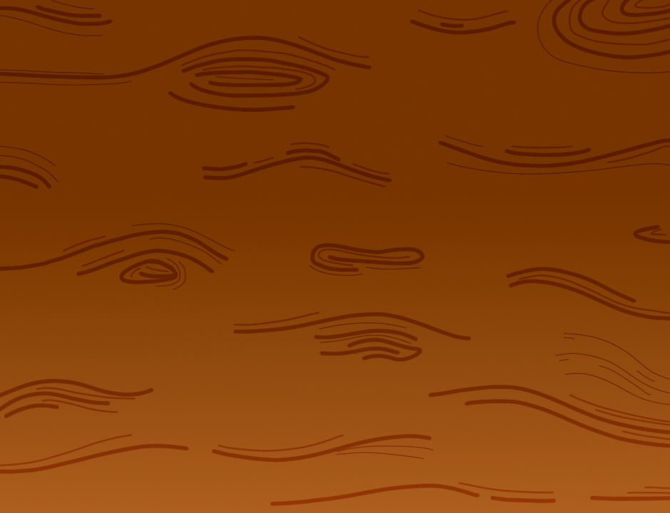 | `Botao.png` | Fundo dos botões da interface (textura de madeira) |
| 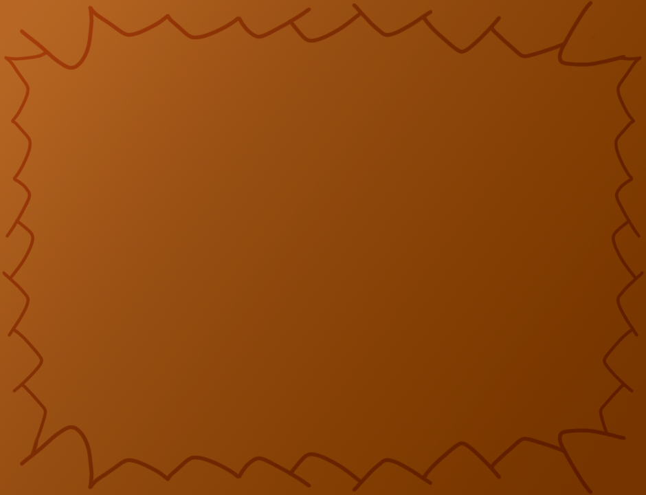 | `botaoAtaque.png` | Fundo do botão de ataque, no centro da batalha |
| 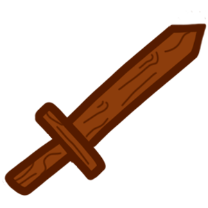 | `espada.png` | Ícone da espada sobre o botão de ataque |

## Decisões e adaptações

- O PDF permite alterar os valores numéricos das regras. As adaptações (velocidade como chance de ataque extra, penalidade do primeiro turno, ordem fixa de cartas dentro de cada turno e as habilidades únicas) mantêm os cinco atributos e a ordem de resolução do ataque.
- O layout da batalha foi pensado para o celular deitado entre os dois jogadores: cartas, status e log do Jogador 2 ficam virados 180°, e o botão de ataque fica no centro.
- A prévia da Velocidade na distribuição mostra a chance real de ataque extra de cada carta.
- A morte da carta usa pedaços que se soltam (e não um shader de dissolução), o que funciona igual em todos os aparelhos.

## Créditos

- **Desenvolvimento:** Gabriel Jaycon
- **Personagens:** originais (os Goblins), sem personagens de franquias comerciais
- **Fonte:** MedievalSharp, Copyright (c) 2011 wmk69 (wmk69@o2.pl), licenciada sob a SIL Open Font License 1.1 (texto completo em `docs/licencas/OFL-MedievalSharp.txt`)
